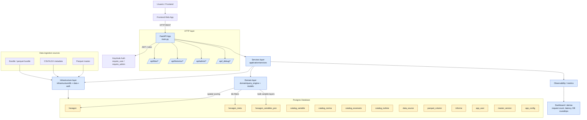

# Vento — Backend (FastAPI)

Backend del proyecto Vento, reconstruido en **FastAPI** con **Clean Architecture / DDD**.

- **Autenticación (toda la API):** **guard dual** `require_user` — acepta el **JWT de Keycloak** (RS256 vía JWKS) **o** el **header interno del BFF** (`X-Internal-Secret` + `X-User-Sub`/`X-User-Roles`) y valida roles.
- **Mapa:** sirve hexágonos por tile y — método principal del informe — **por ÁREA**: recibe el polígono del área seleccionada y devuelve solo los hexágonos de esa área con su **score general**, **scores por dimensión** y **detalle**.
- **Histórico:** persiste los informes **por usuario** en **Postgres** (se guardan los parámetros compactados, nunca el PDF).

## Estructura

```
back_elements/
├── main.py                         # App FastAPI (CORS, warmup, routers, lifespan)
├── shared/config.py                # Config por env (parquet, DB, Keycloak, CORS)
├── domain/                         # Núcleo puro (sin FastAPI ni DB)
│   ├── models/hexagon.py           #   HexagonData, TileHex, HexDetail, AreaHex
│   └── query_engine/               #   engine + spatial_resolver + aggregator + variable_engine
├── application/services/           # Orquestación (tile_service, historial_service)
├── infrastructure/
│   ├── spatial/tile_index.py       #   Índice H3 en memoria
│   ├── data/parquet_reader.py      #   Lectura del .h3.parquet
│   ├── auth/keycloak_guard.py      #   Verificación JWT + roles + usuario en BD
│   └── db/                         #   session + models (ORM) + repository
├── api/routers/                    # tiles.py · historial.py · admin_*.py
├── migrations/                     # Alembic schema versioning
├── tools/                          # scripts de ingest y benchmark
└── tests/                          # unit + integration tests
```

## Endpoints (bajo `/api`)

| Método | Ruta | Descripción | Guard |
|--------|------|-------------|-------|
| GET  | `/api/health` | Estado + índice listo | — |
| GET  | `/api/_debug/inflight` | Peticiones en vuelo | — |
| GET  | `/api/_debug/stats` | Memoria + estado del worker | — |
| GET  | `/api/tiles/warmup` | Carga el parquet en memoria / metadata | JWT |
| GET  | `/api/tiles/variables` | Variables disponibles | JWT |
| GET  | `/api/tiles/counts` | Conteos por zoom y variable | JWT |
| GET  | `/api/tiles/detail/{h3_index}` | Detalle de un hex | JWT |
| GET  | `/api/tiles/excluded` | Celdas excluidas | JWT |
| GET  | `/api/tiles/{z}/{x}/{y}` | Hexes de un tile | JWT |
| POST | `/api/tiles/heatmap/area` | Heatmap por área | JWT |
| POST | `/api/tiles/variable` | Capa de una variable | JWT |
| POST | `/api/tiles/variables-bulk` | Múltiples capas a la vez | JWT |
| POST | `/api/tiles/area` | ÁREA → scores + detalle | JWT |
| GET  | `/api/historico` | Informes del usuario | JWT |
| POST | `/api/historico` | Guardar informe | JWT |
| DELETE | `/api/historico/{informe_id}` | Eliminar informe propio | JWT |
| GET  | `/api/admin/catalog/variables` | Variables del catálogo | Auth + user |
| GET  | `/api/admin/catalog/master-codes` | Códigos reales de la master | Admin |
| POST | `/api/admin/catalog/variables` | Crear variable | Admin |
| PATCH | `/api/admin/catalog/variables/{var_id}` | Actualizar variable | Admin |
| PATCH | `/api/admin/catalog/datasets/{var_id}` | Actualizar versión de dataset | Admin |
| GET  | `/api/admin/catalog/hierarchy` | Jerarquía dimensión→criterio→subcriterio→variable | Auth + user |
| POST | `/api/admin/catalog/metadata/upload` | Subir CSV/XLSX de metadatos | Admin |
| POST | `/api/admin/catalog/metadata/plan` | Planificar columnas de metadatos | Admin |
| GET  | `/api/admin/catalog/metadata/mappings` | Mapeos de metadatos | Admin |
| POST | `/api/admin/catalog/metadata/mappings` | Insertar/actualizar mapping | Admin |
| POST | `/api/admin/catalog/metadata/apply` | Aplicar ingesta de metadatos | Admin |
| POST | `/api/admin/catalog/economic/plan` | Plan económico | Admin |
| POST | `/api/admin/catalog/economic/apply` | Aplicar datos económicos | Admin |
| GET  | `/api/admin/catalog/economic/panels` | Paneles económicos | Auth + user |
| GET  | `/api/admin/catalog/economic/series` | Series económicas | Auth + user |
| GET  | `/api/admin/catalog/economic/scenarios` | Escenarios económicos | Auth + user |
| GET  | `/api/admin/catalog/normas` | Listar normas | Auth + user |
| POST | `/api/admin/catalog/normas` | Crear norma | Admin |
| PATCH | `/api/admin/catalog/normas/{norma_id}` | Actualizar norma | Admin |
| DELETE | `/api/admin/catalog/normas/{norma_id}` | Borrar norma | Admin |
| GET  | `/api/admin/catalog/escenarios` | Listar escenarios | Auth + user |
| POST | `/api/admin/catalog/escenarios` | Crear escenario | Admin |
| PATCH | `/api/admin/catalog/escenarios/{esc_id}` | Actualizar escenario | Admin |
| DELETE | `/api/admin/catalog/escenarios/{esc_id}` | Borrar escenario | Admin |
| GET  | `/api/admin/catalog/turbines` | Listar turbinas | Auth + user |
| PATCH | `/api/admin/catalog/turbines/{turbine_id}` | Actualizar turbina | Admin |
| POST | `/api/admin/catalog/turbines` | Crear turbina | Admin |
| DELETE | `/api/admin/catalog/turbines/{turbine_id}` | Borrar turbina | Admin |
| GET  | `/api/admin/catalog/config/{key}` | Valor config por clave | Auth + user |
| PATCH | `/api/admin/catalog/config/{key}` | Actualizar config | Admin |
| GET  | `/api/admin/master/status` | Estado de la master | Admin |
| POST | `/api/admin/master/update` | Programar o lanzar update de master | Admin |
| POST | `/api/admin/bundle/upload` | Subir bundle | Admin |
| POST | `/api/admin/bundle/plan` | Plan del bundle | Admin |
| GET  | `/api/admin/bundle/columns` | Registro columna→clase | Admin |
| PATCH | `/api/admin/bundle/columns/{name}` | Concilia/crea columna | Admin |
| POST | `/api/admin/bundle/columns/{name}/rename` | Renombrar columna | Admin |
| POST | `/api/admin/bundle/apply` | Aplicar bundle | Admin |
| POST | `/api/admin/bundle/apply-detached` | Aplicar bundle en proceso aislado | Admin |
| POST | `/api/admin/bundle/chunks` | Generar plan de chunks | Admin |
| POST | `/api/admin/bundle/apply-chunk` | Ingesta un chunk | Admin |
| POST | `/api/admin/bundle/finalize` | Finaliza ingesta del bundle | Admin |
| GET  | `/api/admin/db/overview` | Resumen de tablas + diffs variables | Admin |

`POST /api/tiles/area` — body:
```json
{ "polygon": [[lng, lat], ...] }        // o  { "hexes": ["87...", ...] }
```
respuesta: `[{ "h3_index", "lat", "lng", "score_general", "scores": {"TEC":0.8,...}, "tipo_celda", "variables": {...} }]`

## Arquitectura completa del backend y puntos de cuello de botella

### Diagrama de arquitectura



### Capas funcionales

1. HTTP / API layer
   - `api/routers/*.py`
   - Expone los endpoints REST y valida autenticación/roles.
   - Se monta en `main.py` con prefijos `/api`.

2. Services / Application layer
   - `application/services/*.py`
   - `tile_service`, `historial_service`, `catalog_service`, `master_service`, `bundle_service`, `metadata_ingest`, `economic_ingest`, `config_service`, etc.
   - Orquesta repositorios, validaciones y lógica de negocio.

3. Domain / core logic
   - `domain/query_engine/`
   - Calcula scoring, agregación espacial, geolocalización H3, variables, heatmaps, área y detalle.
   - Debe ser el núcleo de rendimiento y modelado del mapa.

4. Infrastructure / persistence
   - `infrastructure/db/`
   - ORM SQLAlchemy, session factory, repositorios, lectura de parquet/csv/xlsx, Keycloak guard.

5. Persistence / data store
   - PostgreSQL con tablas específicas para el mapa, historial, catálogo y metadatos.

6. Ingest & operational scripts
   - `tools/ingest_parquet.py`, `tools/ingest_docs.py`, `tools/ingest_bundle.py`
   - Cargan datasets de master, documentos, bundles y actualizan la base de datos.

### Tabla principal de la base de datos

| Tabla | Propósito | Impacto rendimiento |
|-------|-----------|---------------------|
| `hexagon` | Celdas H3 del mapa + score_general + variables + scores | Alto: es la tabla más consultada por mapa |
| `hexagon_meta` | `vmin`, `vmax` por variable para normalizar | Medio |
| `hexagon_variables_pon` | Variables ponderadas por h3 | Medio/alto |
| `catalog_variable` | Catálogo de variables + flags de UI/modelo | Medio |
| `catalog_norma` | Normas regulatorias | Bajo |
| `catalog_escenario` | Escenarios económicos | Bajo |
| `catalog_turbine` | Turbinas / capacidad / área | Bajo |
| `data_source` | Registro de ingestas y fuentes | Bajo |
| `parquet_column` | Concilación schema-agnóstico del bundle | Medio |
| `informe` | Informes guardados por usuario | Medio |
| `app_user` | Espejo local del usuario Keycloak | Bajo |
| `master_version` | Estado/versión de la master y actualizaciones | Medio |
| `app_config` | Config clave→valor editable | Bajo |
| `economic_panel` / `economic_series` | Panel económico | Medio |
| `catalog_dimension` / `catalog_criterio` / `catalog_subcriterio` | Jerarquía del modelo | Bajo/medio |

### Endpoints más sensibles a cuello de botella

Los endpoints más probables de generar latencia o saturación son los siguientes:

| Endpoint | Tipo de carga | Riesgo | Motivo |
|----------|---------------|--------|--------|
| `GET /api/tiles/{z}/{x}/{y}` | Mapa / tile | Alto | Bbox + H3 + lectura de gran volumen |
| `GET /api/tiles/detail/{h3_index}` | Mapa | Bajo | PK pero alta frecuencia |
| `GET /api/tiles/counts` | Agregación | Medio | Agregado por zoom/var / dataset grande |
| `POST /api/tiles/area` | Informe por área | Muy alto | Requiere procesar varias celdas y scores |
| `POST /api/tiles/variable` | Geomapping | Alto | Puede hacer scans grandes por bbox |
| `POST /api/tiles/variables-bulk` | Bulk map layers | Muy alto | Múltiples capas + bbox + O(N) |
| `POST /api/admin/bundle/apply` | Ingesta bundle | Muy alto | Escrituras + transforms + JSONB |
| `POST /api/admin/bundle/apply-detached` | Ingesta grande | Muy alto | Puede bloquear worker y memoria |
| `POST /api/admin/catalog/metadata/apply` | Ingesta metadata | Medio/alto | Procesa Excel/CSV y actualiza catálogo |
| `POST /api/admin/catalog/economic/apply` | Ingesta económico | Alto | Carga hojas y series largas |
| `GET /api/admin/db/overview` | Diagnóstico | Medio | SQLs sobre información_schema + varios joins |

### Métricas por sesión recomendadas para detectar cuellos de botella

Para analizar rendimiento con tablas de 30M+ filas, el contador más útil no es solo “número de requests”, sino los siguientes indicadores por sesión:

| Métrica por sesión | Descripción | Umbral de alerta |
|--------------------|-------------|------------------|
| `req_total` | Requests HTTP totales | > 30 en sesión activa |
| `expensive_calls` | Calls que disparan consultas pesadas | > 10 |
| `db_roundtrips` | Consultas SQL ejecutadas por sesión | > 80 |
| `rows_scanned` | Filas leídas por sesión | > 150M |
| `p95_latency_ms` | Latencia p95 para cada endpoint | > 2000 ms |
| `inflight_requests` | Requests concurrentes | > 12 simultáneas |
| `failed_requests` | Requests fallidos/error 5xx | > 3%

### Regla práctica de rendimiento, útil para este backend

Con tablas grandes, se puede alertar así:

- Verde: `expensive_calls <= 5` y `rows_scanned < 50M`
- Aviso: `expensive_calls 6-10` o `rows_scanned 50M-150M`
- Rojo: `expensive_calls > 10` o `rows_scanned > 150M`
- Crítico: `expensive_calls > 20` o `p95_latency_ms > 5000`

### Umbrales por tipo de endpoint

| Tipo de endpoint | Regla útil |
|------------------|------------|
| Mapa / tiles | > 10 llamadas pesadas por sesión = riesgo alto |
| Área/informe | > 5 llamadas por sesión con p95 > 2s = riesgo alto |
| Admin ingest | > 3 operaciones pesadas por sesión = riesgo crítico |
| Catálogo/metadata | > 8 peticiones por sesión = vigilancia |

### Señales de cuello de botella típicas en esta app

- Bbox grandes o mapas con muchas celdas H3
- Repeated scans de `hexagon` cuando no hay filtro/índice eficiente
- JSONB con muchos campos en `hexagon.variables`, `hexagon.scores` o `catalog_variable` sin un diseño de indexación adecuado
- Múltiples llamadas a endpoints de capa/heatmap/bulk en una misma sesión
- `tiles/area` y `tiles/variables-bulk` ejecutando varias consultas progresivas con el mismo dataset
- Ingesta masiva en `bundle` y `metadata` durante la misma sesión, generando picos de escritura y memoria

### Recomendación para observabilidad

La mejor observabilidad para este backend es un middleware que capture por request:

```python
request_id
user_sub
endpoint
method
duration_ms
status_code
db_roundtrips
rows_scanned
expensive_call
```

Y luego agregarlas por sesión o por usuario en un dashboard. El patrón que más ayuda en bases con 30M+ filas es:

- request count por endpoint
- p95 latency por endpoint
- total DB round trips por sesion
- total rows scanned por session
- expensive_calls_session > 10 => alert

## Endpoints completos agrupados por funcionalidad

### 1) Salud y diagnóstico
- `GET /api/health`
- `GET /api/_debug/inflight`
- `GET /api/_debug/stats`

### 2) Mapa / tiles
- `GET /api/tiles/warmup`
- `GET /api/tiles/variables`
- `GET /api/tiles/counts`
- `GET /api/tiles/detail/{h3_index}`
- `GET /api/tiles/excluded`
- `GET /api/tiles/{z}/{x}/{y}`
- `POST /api/tiles/heatmap/area`
- `POST /api/tiles/variable`
- `POST /api/tiles/variables-bulk`
- `POST /api/tiles/area`

### 3) Histórico de usuario
- `GET /api/historico`
- `POST /api/historico`
- `DELETE /api/historico/{informe_id}`

### 4) Administración del catálogo
- `GET /api/admin/catalog/variables`
- `GET /api/admin/catalog/master-codes`
- `POST /api/admin/catalog/variables`
- `PATCH /api/admin/catalog/variables/{var_id}`
- `PATCH /api/admin/catalog/datasets/{var_id}`
- `GET /api/admin/catalog/hierarchy`
- `POST /api/admin/catalog/metadata/upload`
- `POST /api/admin/catalog/metadata/plan`
- `GET /api/admin/catalog/metadata/mappings`
- `POST /api/admin/catalog/metadata/mappings`
- `POST /api/admin/catalog/metadata/apply`
- `POST /api/admin/catalog/economic/plan`
- `POST /api/admin/catalog/economic/apply`
- `GET /api/admin/catalog/economic/panels`
- `GET /api/admin/catalog/economic/series`
- `GET /api/admin/catalog/economic/scenarios`
- `GET /api/admin/catalog/normas`
- `POST /api/admin/catalog/normas`
- `PATCH /api/admin/catalog/normas/{norma_id}`
- `DELETE /api/admin/catalog/normas/{norma_id}`
- `GET /api/admin/catalog/escenarios`
- `POST /api/admin/catalog/escenarios`
- `PATCH /api/admin/catalog/escenarios/{esc_id}`
- `DELETE /api/admin/catalog/escenarios/{esc_id}`
- `GET /api/admin/catalog/turbines`
- `PATCH /api/admin/catalog/turbines/{turbine_id}`
- `POST /api/admin/catalog/turbines`
- `DELETE /api/admin/catalog/turbines/{turbine_id}`
- `GET /api/admin/catalog/config/{key}`
- `PATCH /api/admin/catalog/config/{key}`

### 5) Master / dataset updates
- `GET /api/admin/master/status`
- `POST /api/admin/master/update`

### 6) Bundle / ingesta masiva
- `POST /api/admin/bundle/upload`
- `POST /api/admin/bundle/plan`
- `GET /api/admin/bundle/columns`
- `PATCH /api/admin/bundle/columns/{name}`
- `POST /api/admin/bundle/columns/{name}/rename`
- `POST /api/admin/bundle/apply`
- `POST /api/admin/bundle/apply-detached`
- `POST /api/admin/bundle/chunks`
- `POST /api/admin/bundle/apply-chunk`
- `POST /api/admin/bundle/finalize`

### 7) Administración de base de datos / diagnóstico
- `GET /api/admin/db/overview`

## Correr en local

```bash
cd back_elements
python -m venv .venv && source .venv/bin/activate
pip install -r requirements.txt
cp .env.example .env          # ajustar DATABASE_URL / KEYCLOAK_ISSUER / PARQUET_PATH
uvicorn main:app --reload --port 8000
```

Requiere **Postgres** (para el histórico y la verificación de usuario) y **Keycloak** (realm `vento`). La **autenticación es obligatoria** (no configurable): todos los endpoints de datos exigen JWT válido o header interno del BFF.

## Datos reales

- Parquet maestro → **`data/master_variables.h3.parquet`** (ver [data/README.md](data/README.md)).
- Normalizar códigos → nombres en [`infrastructure/data/variable_catalog.py`](infrastructure/data/variable_catalog.py).
- Pasos completos de prueba: **[PRUEBAS-DATOS-REALES.md](PRUEBAS-DATOS-REALES.md)**.

> Migraciones: en dev las tablas se crean solas al arrancar (`init_db`). En prod usar Alembic.

## Límites de concurrencia por endpoint (capacidad)

Medido con `tools/loadtest.py` en el server de **2 workers / ~2 GB**. Techo =
usuarios concurrentes antes de degradar (err>25% o p95>8 s). "Por GB" ≈ 1 worker ≈
18 operaciones de BD concurrentes por cada ~1 GB de RAM (escala con workers).

| Endpoint | Techo (2 GB) | ≈ por GB | Cuello | Datos movidos / request |
|---|---|---|---|---|
| `GET /tiles/detail` | ~100 | ~50 | app (2 workers) | 1 hex · 1 fila (~0,7 KB) · PK |
| `POST /tiles/area` | ~100 | ~50 | app | 20–300 hexes (res8) · ~0,06–0,22 MB · PK/IN |
| `GET /tiles/variables` | ~100 | ~50 | app | 62 filas meta (~KB) |
| `GET /tiles/warmup` | ~50 → **>100** (fix) | ~25 → >50 | BD (`count(*)`) | estimado `reltuples` (0 filas; antes ~954 MB) |
| `GET /tiles/excluded` | scan ~30 s → ms (índice+caché) | — | BD (sin índice) | solo `h3_index` excluidos |
| `POST /tiles/variables-bulk` | **~10** | ~5 | **BD** (scan bbox) | hasta ~221 K filas × ~0,7 KB ≈ **165 MB leídos** |

Detalle, herramientas y configuración: **[docs/ops/documento-tecnico-comportamiento-herramientas-config.md](../../docs/ops/documento-tecnico-comportamiento-herramientas-config.md)** · evidencia: **[docs/testing/benchmark-carga-h3-2026-09-30.md](../../docs/testing/benchmark-carga-h3-2026-09-30.md)**.
